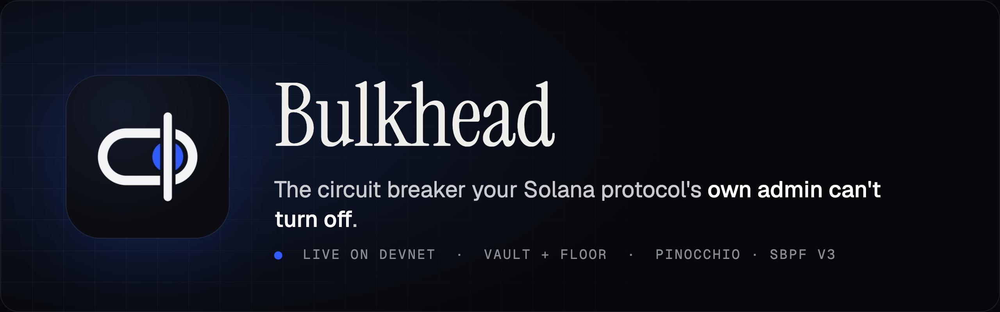
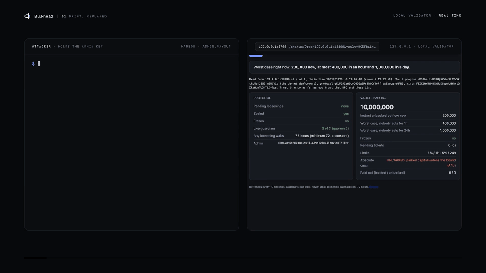
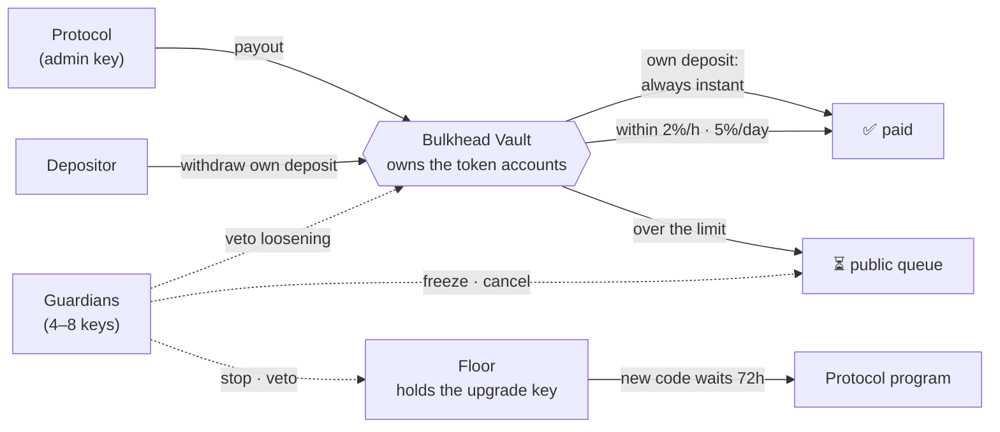

<p align="center">
  
</p>

<p align="center">
  <a href="https://github.com/shuv-amp/bulkhead/actions/workflows/ci.yml"></a>
  <a href="#live-on-devnet"></a>
  <a href="docs/09-VERIFICATION.md"></a>
  <a href="docs/09-VERIFICATION.md"></a>
  <a href="SECURITY.md"></a>
  <a href="LICENSE"></a>
</p>

<p align="center">
  <a href="#what-it-does-to-an-attack"><b>The attack</b></a> ·
  <a href="#how-it-works"><b>How it works</b></a> ·
  <a href="#verify-it-yourself"><b>Verify it</b></a> ·
  <a href="#live-on-devnet"><b>Devnet</b></a> ·
  <a href="docs/FAQ.md"><b>FAQ</b></a> ·
  <a href="#documentation"><b>Docs</b></a>
</p>

---

On 1 April 2026, **Drift lost $285M in about twelve minutes.** Drift had withdrawal limits. The attacker, holding admin power, raised them. Drift had removed its own timelock five days earlier.

Bulkhead is a small Solana program that holds a protocol's token accounts on the protocol's behalf. Once it's audited, its upgrade key is burned and nobody can change it. Until then, on devnet, a disclosed team key can.

> **The protocol still decides who gets paid. Bulkhead decides how fast.**

<p align="center">
  
  <br>
  <sub>A drain with the admin key, on a local validator (13 Oct 2026, sped up). 1.2M ordered, 100,000 paid; the guardian freezes and cancels the rest.<br>Every script is in this repo: <code>cloud/e2e/attack.mjs</code>, <code>cloud/guardian/main.mjs</code>, <code>cloud/status/</code>.</sub>
</p>

## The rules

| Rule | What it means |
|---|---|
| 🟢 **Your own money is never held** | Taking back your own deposit is never throttled, frozen or priced. No oracle, no limit, no freeze. |
| 🔵 **Everything else is rate-limited** | Limits refill at **2% of the vault per hour** and **5% per day**. Of the payouts *asked for* in any hour, at most 4% are paid within that hour, and of a day's, at most 10% within that day. Anything above that waits at least 6 hours in a public queue any guardian can cancel, and is paid later, possibly in one go. |
| ⏳ **Loosening takes 72 hours** | Tightening is instant. Loosening waits 72h, a constant no admin can lower, and any guardian can veto it. |
| 🛑 **Guardians stop, never steal** | Any guardian can freeze, veto or stop. None can move a single token. |
| 🔒 **The upgrade key is fenced too** | Floor holds the program's upgrade key. New code waits 72h in public; one guardian can stop the program; a quorum restores it byte for byte. |

<details>
<summary><b>What "2% per hour" means exactly</b></summary>

<br>

The percentages apply to the least of the live balance, its 24-hour average and its lowest balance of the last 30 to 60 minutes. A deposit made just before an attack buys almost nothing, capital held for a single transaction (a flash loan) buys nothing, and money that has left stops counting at once. Each rate refills a bucket of the same size, so of the payouts requested from any moment on, at most **4% are paid within the hour and 10% within the day**. Above that, payouts wait at least 6 hours in a public queue that guardians can freeze and cancel. These limits count payouts when they are asked for, not when they land. Queued payouts can come due together, and a ticket that is due can be settled later, so this is not a cap on what leaves in a given clock hour. At the defaults, a single request can be as large as 40% of the vault (it is then due 7 days later) and is paid in one transfer, and tickets asked for over several days can all be settled at the same moment (19 fit in one legacy transaction), with no cap but the limits at the time they were asked for: with nobody cancelling, the whole vault 19 days after the first request. Every such payout sits in a public queue for at least 6 hours first, and any guardian can cancel it (`docs/09`, finding 102).

Protocols should also set absolute caps in tokens: they bound an attacker who parks their own capital in the vault first ([15](docs/15-ADVERSARIAL-REVIEW.md)).

The one exception is a loan against allowlisted, Pyth-priced collateral. It is bounded by haircuts and Pyth, not by the limiter, and a guardian's freeze stops new ones ([threat model](docs/04-THREAT-MODEL.md), T5; [finding 90](docs/09-VERIFICATION.md#4-what-this-process-found-every-item-fixed-or-stated)).

</details>

## Why the brake has to sit where the money moves

| Fact | Source |
|---|---|
| Of 54 multisigs governing solgov-tracked Solana protocols, **37 have no timelock**; the longest is **24h**; **16 of 43** have changed theirs | [our census](evidence/solgov_census.py), snapshot 26 Sep 2026, spot-checked on-chain |
| In 183 DeFi hacks, **1 of 87** protocols with a pause used it within the first hour; **44%** of attacks were a single transaction | Zhou et al., IEEE S&P 2023 |
| Since 15 Sep 2026, one Solana transaction can be **4,096 bytes** (was 1,232) | SIMD-0296 |

Timelocks are settings, not floors. Stop buttons act after the transaction that did the damage. Only a limit enforced inside every payout bounds an atomic attack.

**On Solana, the one control an admin or upgrade key can't get around is ownership of the token account. Bulkhead becomes that owner.**

## How it works



### Two tiers, two threats

| | **Vault** (Tier 1) | **Floor** (Tier 0) |
|---|---|---|
| What it holds | The protocol's token accounts | The program's upgrade key |
| Stops | Money leaving too fast, whatever the cause: a stolen admin key (the Drift class), a buggy payout path, malicious new code in the protocol, even a one-transaction drain | Malicious *new code*: new binaries wait 72h in public, any guardian can stop the program at once, and a quorum restores the exact bytes that were stopped |
| Does **not** stop | Outflow within the limits when nobody responds: up to 10% of the vault asked for and paid within a day, plus queued payouts once they are due, which can land together (finding 102). Guardians and alerts cover that. | A drain through the existing code's own admin instructions, which is how Drift was drained. Only Vault bounds that. |
| Adoption | The protocol routes deposits and withdrawals through it: easiest for new launches and relaunches | One transaction, zero code changes, for any upgradeable program (shown on a real 1 MB mainnet program: `scripts/floor-demo.sh`) |

**Who the guardians are.** When a protocol registers, it names 4–8 guardian keys: for example its operations key, the Bulkhead Cloud bot and two security firms. Only guardians that heartbeat count. Any one of them can freeze, veto or stop, and none can move money. A live quorum of the others ejects a rogue guardian instantly (a new set has at least two keys more than its threshold, so after any two lost or rogue keys the others still reach one, unless the rogues are a quorum themselves: two in a 2-of-n set), so a stolen guardian key means denial of service until then, never theft.

**Who pays.** The core is free and open source. Protocols pay for Bulkhead Cloud: a hosted guardian, limit calibration on their own flows, and an attestation feed. They pay because the capital under the admin asks for it. Depositors, curators and allocators want a worst case that is enforced, not promised, and the program publishes it (`attest`): "at most $X now, $Y in the next hour, $Z in a day, on top of $Q already queued in public" through the unbacked lane, with absolute caps set. It excludes oracle risk on backed loans. A patient attacker who paces payouts under the bot's thresholds is bounded by the on-chain limits, not by the bot ([15](docs/15-ADVERSARIAL-REVIEW.md) A2).

<details>
<summary><b>Why not just an abort binary?</b></summary>

<br>

Dean Little's `sbpf-asm-abort` showed that a program can be stopped by upgrading it to a tiny binary that always fails. Floor builds on that pattern (credited in [DISCLOSURE.md](DISCLOSURE.md)). A bare abort, though:
- is pressed by whoever holds the upgrade key, the same key that can deploy anything;
- waits for the timelock under a timelocked multisig;
- is undone only by re-uploading the program.

Floor separates stopping from upgrading. Any guardian stops, new code waits 72h, and a quorum restores the stopped code, verified byte-identical. No stop button, bare or Floor's, reaches inside a transaction, and none bounds a drain through admin instructions. That is Vault's job. Details: [`06 §2`](docs/06-FLOOR.md#2-floor-versus-a-bare-abort-binary). More questions: [FAQ](docs/FAQ.md).

</details>

## What it does to an attack

**Measured, end to end** (`E2E=1 scripts/check-programs.sh`). The setup: a local validator, the programs, a 10M USDC vault, the Cloud guardian, and an attacker holding the demo protocol's admin key.

| | Result |
|---|---|
| The attacker orders | 12 payouts of 100,000 USDC, one every 800 ms |
| The attacker receives | **100,000 USDC**. The burst is 2% of what is in the vault at each payout, so after the first 100,000 the second no longer fits. An attacker who sizes each payout exactly gets 199,000 (S8), never more than 2%. |
| The guardian | Freezes the protocol on its own, seconds after the second payout, then cancels all 11 queued payouts. In a local-validator run with three guardians: 5.4–5.6 s after the first payout with a healthy RPC (the freeze confirms 2–3 s after the payout that crosses the threshold); 13–20 s with every RPC call delayed 1.5 s (`09`, finding 82) |
| Afterwards | 9,900,000 USDC still in the vault; 0 payouts pending; the status page's figures equal the program's own `attest` |

**Modeled: the Drift incident** (`reference/drift_model.py`). Inputs: Chainalysis per-asset amounts, and a $550M TVL **assumption** with vaults proportional to what was drained. It is a model, not a replay.

| Nobody freezes for | Loss behind Bulkhead | Share of TVL |
|---|---|---|
| 2 minutes (an assumed guardian freeze: 5–20 s on a local validator, not yet measured on mainnet) | $11.4M | 2.1% |
| 1 hour | $22.0M | 4.0% |
| 24 hours | $55.0M | 10.0% |
| Actual, without Bulkhead | **$285M in ~12 minutes** | 52% |

With nobody responding at all, half a vault takes **9 days** to leave instead of 12 minutes.

## Verify it yourself

**In seconds, with nothing to build** (Node 20+ or Python 3.9+): the live devnet market, as the status page shows it.

```bash
node cloud/status/snapshot.mjs https://api.devnet.solana.com HK5FbaLtvNSPHj9HYbuStfVxXktkoMejJ9GEjn8WCY1b \
  6w9t76W2w8q38xTvUPuDDzSwrjTKbq4dM8nAckYXScYh CBK36QrH6fzjrDYwkKHF6jeEAEfHcm8iSVN9BZrCxHSB
python3 tools/floor_check.py dRiftyHA39MWEi3m9aunc5MzRF1JYuBsbn6VPcn33UH   # any mainnet program; add --rpc https://api.devnet.solana.com for a devnet one
```

The status page itself is a static file that needs a local web server (browsers refuse its module imports from `file://`): run `python3 -m http.server -d cloud 8000` and open [this link on localhost](http://localhost:8000/status/?rpc=https%3A%2F%2Fapi.devnet.solana.com&vault=HK5FbaLtvNSPHj9HYbuStfVxXktkoMejJ9GEjn8WCY1b&protocol=6w9t76W2w8q38xTvUPuDDzSwrjTKbq4dM8nAckYXScYh&mints=CBK36QrH6fzjrDYwkKHF6jeEAEfHcm8iSVN9BZrCxHSB&floor=HARLZqMwqocBnbhbSTWkd5i8EHmjHXLHr1T9su3SR31E&protected=CvZEMDwMaD8zDsWjvj8RgR2M2MNyFeoW5b4DYEz6eWbs), which fills in the devnet market and the Floor-protected S10 program.

**In about two minutes each** (on a machine with the toolchains; the first run downloads Rust 1.92.0, the tests' pinned nightly and Solana's platform-tools):

```bash
scripts/check.sh                  # the core, the reference, the tools, Cloud: needs rustup, Python 3.9+, Node 20+
scripts/check-programs.sh         # the programs on the real runtime: needs the Agave CLI v4.3.0:
                                  #   sh -c "$(curl -sSfL https://release.anza.xyz/v4.3.0/install)"
```

<details>
<summary><b>Deeper, and slower: proofs, fuzzing, mutation testing, deploy checks</b></summary>

```bash
E2E=1 scripts/check-programs.sh   # ...plus the attacker-vs-guardian run and a deploy rehearsal, on local validators
scripts/prove.sh                  # Kani bounded proofs (~6 min)
scripts/mutants.sh                # mutation testing (~45 min)
scripts/fuzz.sh                   # coverage-guided fuzzing, 9 targets (SECONDS_PER=600 for longer)
scripts/deny.sh                   # supply chain: RustSec advisories, licences, crate sources
python3 tools/floor_check.py <program-id>   # who can upgrade any mainnet program; is it ready for SIMD-0500? (--rpc <url> for another cluster)
scripts/floor-demo.sh <program-id>          # Floor on that program's real bytes, locally: register, stop, restore byte-identical
scripts/deploy-dryrun.sh                    # the devnet deploy, rehearsed on a fresh local validator
cloud/e2e/guardian-scenarios.sh             # the guardian on a validator: hold, restart, dead RPC, approvals, recovery key (cursor: ~10 min more)
scripts/verify-deployed.sh <url> <id>=<name> # a deployed program runs exactly the code built from this checkout
scripts/verify-devnet.sh                    # the three devnet programs == this checkout's canonical build
scripts/build-programs-docker.sh            # that canonical (Linux x86_64) build on any machine with Docker
scripts/floor-devnet.sh <url> <team.json> <dir>  # Floor's full lifecycle on a live cluster, forbidden actions simulated
node cloud/deploy/vault-check.mjs <url> <market> # a live market checked without sending anything (needs its keys)
```

</details>

These scripts install nothing. The core has zero dependencies, and Cloud and the Python code use only their standard libraries.

### What the checks show

| Check | Result (latest run of each) |
|---|---|
| Programs on the real runtime (LiteSVM, mainnet feature set, mainnet token program) | **161/161**: every scenario (S1 Drift, S4 bank run, S7, S8, S9, S10 Floor), the negative tests, measured compute, and an account-substitution sweep of every instruction (7,075 swaps refused, 16 Oct) |
| Bounded proofs (Kani) and exhaustive checks | **19/19 harnesses verified** on 16 Oct (16 for every value of their types), 240 s of verification ([`09 §5`](docs/09-VERIFICATION.md#5-bounded-proofs-kani-and-exhaustive-checks)). 6 exhaustive tests over ~584M inputs |
| Differential: an independent Python reference vs the Rust core | **6,943,561 lines identical** (6 seeds × 200k cases, 27 Sep); 33 commands now, 300k cases on every pull request and 3M weekly in CI |
| Program vs model | Random steps on-chain, every outcome equal to the core's prediction: 12,000 (Vault), 300,000 with random limits and every brake (Vault), 200,000 (Floor) |
| Mutation testing (`cargo-mutants`: 797 mutants of the core in the last full run, 15 Oct; in CI on every change to the core) | **Every non-equivalent mutant killed**; 22 equivalent mutants, each with the reason it can't change behavior ([`09 §6`](docs/09-VERIFICATION.md#6-mutation-testing)) |
| Coverage-guided fuzzing (libFuzzer, 9 targets: the byte parsers and the full-width limiter and ledger) | 36M–277M executions per target in the 6 Oct run (10 min each), no program bug; every parser fuzzed in that run at full line coverage. That run had 8 targets: the guardian-set parser's, added 14 Oct, has no recorded 10-minute run or coverage measurement ([`09 §2`](docs/09-VERIFICATION.md#2-layers-and-current-results-10-oct-2026)) |
| Property tests (G1–G5, fail closed, tightening, the SIMD-0500 gate, snapshot identity, ejection) | 26/26, with coverage counters so a vacuous pass fails |
| Golden vectors (every worked example in the docs, exact boundaries, the abort binaries' bytes, loader layouts) | 119/119 identical, Rust = Python |
| End to end | [Above](#what-it-does-to-an-attack) |
| On devnet | All three programs run this tree's build (PR #85, 15 Oct), matched byte for byte against CI's build of that commit, upgrade authority checked. **S1 ran there on 1 Oct**: the admin key ordered 1.2M, 100,000 left, the guardian froze and cancelled the other 11. Floor S10 with real transactions: one guardian stops, two restore byte-identical, 17/17 forbidden actions refused ([below](#live-on-devnet)) |
| What this process found in our own code and docs | **105 findings**: real bugs, two overclaimed guarantees, test gaps, deploy-tooling hazards, and the attacks of adversarial reviews and audits. Each is fixed or stated ([`09 §4`](docs/09-VERIFICATION.md#4-what-this-process-found-every-item-fixed-or-stated)); 96–105 were found after the submission: 96–99, 101 and 103 are fixed and run on devnet since 15 Oct; 105 (CI tooling) is fixed; 100, 102 and 104 are stated. The Rust core and the Python reference shared one bug; only a third, independent statement of the rule caught it. |

## Live on devnet

Deployed 28 Sep 2026. All three programs have been upgraded in place since then (same ids, market and seal), most recently on 15 Oct (Floor and Vault; Harbor on 6 Oct). Each runs exactly the canonical build of PR #85, `main` at `3eec968` (Harbor: the same bytes since 6 Oct): Linux x86_64, as CI builds it and as the Solana Foundation's verifiable-build image reproduces it on any machine. CI repeats this check every week.

| Program | Devnet id | sha256 of the build |
|---|---|---|
| Floor | [`HARLZqMwqocBnbhbSTWkd5i8EHmjHXLHr1T9su3SR31E`](https://explorer.solana.com/address/HARLZqMwqocBnbhbSTWkd5i8EHmjHXLHr1T9su3SR31E?cluster=devnet) | `508e5a99…c406c16b` |
| Vault | [`HK5FbaLtvNSPHj9HYbuStfVxXktkoMejJ9GEjn8WCY1b`](https://explorer.solana.com/address/HK5FbaLtvNSPHj9HYbuStfVxXktkoMejJ9GEjn8WCY1b?cluster=devnet) | `d2994425…8665544d` |
| Harbor (demo protocol) | [`6w9t76W2w8q38xTvUPuDDzSwrjTKbq4dM8nAckYXScYh`](https://explorer.solana.com/address/6w9t76W2w8q38xTvUPuDDzSwrjTKbq4dM8nAckYXScYh?cluster=devnet) | `543be60b…10adeb40` |

```bash
scripts/verify-devnet.sh   # builds natively on Linux x86_64, in Docker elsewhere, then compares with devnet
```

A Mac build orders the Vault's functions differently, so compare with that build, not a local one ([`09`, finding 43](docs/09-VERIFICATION.md#4-what-this-process-found-every-item-fixed-or-stated)). All three programs share one upgrade authority, a team key disclosed with the full hashes in [SECURITY.md](SECURITY.md#devnet-deployment).

- **The demo market:** Harbor over a Vault holding 10,000,000 test USDC (protocol [`26dY2HWr…`](https://explorer.solana.com/address/26dY2HWrczKyPYh8jB4cBgzFsf5gkYo789BfCBQXRvSq?cluster=devnet)). Sealed on 1 Oct, after the 72h review that follows a seal proposal; until then no payout of any kind was possible.
- **S1 ran there** with `cloud/e2e/s1.sh`, the script of the local end-to-end run: the admin key ordered 12 payouts of 100,000 USDC; the [first paid out](https://explorer.solana.com/tx/2zBFf6Ho6oQLULthoJfHtpqYWGfz3NmJbbxFo3JqbceQFQNeq4d6nnHsfTRYHoPtA7RTmRQAqTTZne4zbg64fUKb?cluster=devnet) (the 2% burst) and 11 queued. The Cloud guardian [froze the protocol](https://explorer.solana.com/tx/3mjsHTaPDCu7q5MdtSZyYgBBUCSAxMDtnH4wPe6RPe49GYJWcE266fHbC51pgpyXMKtQGgeNErL4YGpCngSH5nUR?cluster=devnet) and cancelled all 11, leaving 9,900,000 in the vault. It froze about 13 minutes after the first payout, not seconds as it does locally: a mistyped Compute Budget id made the node refuse every freeze until the id was corrected and the guardian restarted. A queued payout waits at least 6h, so nothing more could leave. The guardian now drops a refused compute budget and sends the freeze without it ([`09`, finding 47](docs/09-VERIFICATION.md#4-what-this-process-found-every-item-fixed-or-stated)). The devnet Vault names its protocol in every event (finding 64), as this guardian requires.
- **Floor S10:** a target program ([`CvZEMDwM…`](https://explorer.solana.com/address/CvZEMDwMaD8zDsWjvj8RgR2M2MNyFeoW5b4DYEz6eWbs?cluster=devnet)) was registered, [stopped by one guardian](https://explorer.solana.com/tx/VzwPxcMzikf5YRxGvoBhH4qWc8hKteDRKYrHPTEkfZ6BeP3t1xmugaKWNiATmQQaAZp3obrLuSxrPP4CYAQ5jhY?cluster=devnet), [restored byte-identical by two](https://explorer.solana.com/tx/4j61VvmWHfdNSgZnvvuzHsVzBML9NXYcfZLT6SU2AEeRtkD5Wyf39bDq4XvwQy77FmS8C92fPzjAZ2WboDLQR9DY?cluster=devnet), and left armed (`scripts/floor-devnet.sh`).

Every signature: [`08`](docs/08-SCENARIOS.md#devnet-signatures).

## Status

> [!WARNING]
> **Not independently audited. Not for real funds.**
>
> What's built: the core math; the on-chain programs (Floor, Vault, and Harbor, a demo protocol); the Cloud guardian; and the status page. They pass their tests on the real Solana runtime (LiteSVM) and on a local validator, and they are [deployed on devnet](#live-on-devnet). An internal pre-audit by six AI-agent reviewers, with each finding reproduced as a test, is in [16](docs/16-AUDIT-REPORT.md). It is not an audit; see [SECURITY.md](SECURITY.md).

## Guarantees

| | Guarantee |
|---|---|
| G1 | Unbacked outflow ≤ `min(C_s(W_s+T)/W_s, C_l(W_l+T)/W_l)` within any `T`, even with admin and upgrade keys stolen ([proof](docs/03-MECHANISM.md#25-proof-of-g1)). For a vault with absolute caps set: without them, capital parked in the vault first widens the base (A1b) |
| G2 | An owner who owes nothing is never throttled, frozen or priced taking back their own deposit. (Whether the tokens are in the pool is the pool's liquidity; [`03 §4.6`](docs/03-MECHANISM.md#46-guarantees-of-the-ledger).) |
| G3 | Backed payouts never leave an owner's ledger unsound at conservative prices |
| G4 | Tighten instantly; loosen only after ≥ 72h, public, vetoable |
| G5 | Guardians can stop, never steal. Only live (heart-beating) guardians act. Unfreezing needs a live quorum. A live quorum of the other guardians can eject a rogue one, in any set larger than its threshold. A new set needs at least `threshold + 2` keys, so any two faults, lost keys or rogue guardians, leave such a quorum unless the rogues are one themselves (two in a 2-of-n set, T7; [findings 96 and 107](docs/09-VERIFICATION.md#4-what-this-process-found-every-item-fixed-or-stated)). |
| G6 | Emergency moves go only into a Bulkhead-held lifeboat. Exits wait 72h, and go only to a destination committed 72h earlier. |
| G7 | Missing, stale or wide prices, unknown assets and overflow only ever reduce what is backed |
| G8 | (Floor) A new binary deploys only after ≥ 72h without veto. While the program is stopped, a live quorum's approval of that exact frozen buffer can deploy it sooner. Any live guardian stops the program instantly; a live quorum restores the snapshot, verified byte-identical to the stopped code. |
| G9 | Bulkhead's and Floor's own upgrade authorities are burned after audit (on devnet: a team key, disclosed) |

## Repository

<details>
<summary><b>Layout</b></summary>

```
crates/bulkhead-core/   the math: dual-bucket GCRA, EMA, value, prices, ledger, classification, governance,
                        Floor checks and abort binaries (zero dependencies, no_std)
crates/bulkhead-diff/   line-protocol worker for the golden tests and the differential runner
programs/floor/         Floor (Tier 0): holds a program's upgrade key; delay, veto, stop, snapshot restore
programs/vault/         Vault (Tier 1): custody, backed ledger, limiter, tickets, governance, lifeboat
programs/harbor/        a deliberately naive demo protocol whose custody is a Bulkhead vault
programs/tests/         LiteSVM: scenarios, negative tests, compute, the program-vs-model differential
cloud/                  zero-dependency JavaScript: client, guardian bot, status page, end-to-end attack,
                        deployment and live-cluster checks
tools/floor_check.py    read-only report on any upgradeable program
tools/claims.py         the counts README and docs/ state, checked against the tree (scripts/check.sh)
tools/mutant_exclusions.py  the mutants .cargo/mutants.toml excludes, checked against cargo-mutants (scripts/mutants.sh)
reference/              independent Python reference, differential runner, golden vectors, fixtures, Drift model
evidence/               governance census (script + committed snapshot), model output
docs/                   the full design (below)
scripts/                check.sh, check-programs.sh, build-programs.sh (+ in Docker), prove.sh, mutants.sh,
                        fuzz.sh, deny.sh, deploy.sh (+ its dry run), verify-deployed.sh, verify-devnet.sh,
                        floor-demo.sh, floor-devnet.sh
fuzz/                   libFuzzer targets (cargo-fuzz) and their committed seeds
.github/workflows/      CI: every pull request, and a deeper run every Monday (docs/09 §8)
```

</details>

The programs use [Pinocchio](https://github.com/anza-xyz/pinocchio) and build for **sBPF v3**. `scripts/build-programs.sh` fails unless each binary is still deployable after SIMD-0500.

## Documentation

**Start here:** [FAQ](docs/FAQ.md) · [03 Mechanism](docs/03-MECHANISM.md) · [04 Threat model](docs/04-THREAT-MODEL.md) · [16 Pre-audit report](docs/16-AUDIT-REPORT.md)

<details>
<summary><b>All 18 documents</b></summary>

<br>

| Doc | What it answers |
|---|---|
| [FAQ](docs/FAQ.md) | Short answers: who pays, who the guardians are, stolen guardian keys, why not a bare abort, what the limits mean exactly |
| [00 Decision](docs/00-DECISION.md) | What we build, what we refuse, and why. Kill criteria. |
| [01 Evidence](docs/01-EVIDENCE.md) | Every number, labelled measured / reported / model / assumption |
| [02 Product](docs/02-PRODUCT.md) | Users, Floor and Vault, guarantees, UX, non-goals, glossary |
| [03 Mechanism](docs/03-MECHANISM.md) | The algorithms, proofs, worked examples, defaults |
| [04 Threat model](docs/04-THREAT-MODEL.md) | Adversaries, bounds, residual risk, invariants → tests |
| [05 Program spec](docs/05-PROGRAM-SPEC.md) | Accounts, instructions, errors, measured compute, Token-2022 policy |
| [06 Floor](docs/06-FLOOR.md) | Tier 0: the upgrade-key floor, stop, snapshot restore, SIMD-0500, and why it beats a bare abort binary |
| [07 Integration](docs/07-INTEGRATION.md) | How a protocol integrates; calibration; Harbor |
| [08 Scenarios](docs/08-SCENARIOS.md) | S1 Drift, S4 bank run, S7 loosen, S8 one-transaction attack, S9 honest borrower, S10 Floor, S11 liquidation cascade: where each runs and what it showed |
| [09 Verification](docs/09-VERIFICATION.md) | The method, every result, every bug it found |
| [10 Build log](docs/10-BUILD-PLAN.md) | What was built when, what was planned and not done, what comes next, risks |
| [11 Business](docs/11-BUSINESS.md) | Market, pricing, go-to-market, competition, moat |
| [12 Submission](docs/12-SUBMISSION.md) | Where to check each claim, go-to-market, prior-code disclosure, team |
| [13 Sources](docs/13-SOURCES.md) | Every URL and source path |
| [14 State of the art](docs/14-STATE-OF-THE-ART.md) | Every mechanism compared with the best shipped systems (Wormhole NTT, CCIP, Kamino, Project 0, MetaMorpho, Lido, Aave, network calculus): what we took, what we rejected, why |
| [15 Adversarial review](docs/15-ADVERSARIAL-REVIEW.md) | An internal red-team pass on the code and the idea: what an attacker who knows every rule gets, what was fixed, what is still open |
| [16 Pre-audit report](docs/16-AUDIT-REPORT.md) | A six-reviewer engagement run like an audit, by AI agents (9 Oct 2026): scope, method, every finding and its status, external assumptions checked, and the design decisions left before a lending integration. Not a substitute for an independent audit |

</details>

## Team

Built full time in Kathmandu, Nepal, by **Shuvam Pandey** ([@shuv-amp](https://github.com/shuv-amp)) and **Praful** ([@Prafyl](https://github.com/Prafyl)) for the Colosseum Crypto World's Fair.

## Credits and license

The one-transaction abort pattern is Dean Little's (`sbpf-asm-abort`); our binaries are generated by our own code. The verification method comes from [SP-Differ](https://github.com/shuv-amp/sp-differ). See [DISCLOSURE.md](DISCLOSURE.md).

[Apache-2.0](LICENSE).
